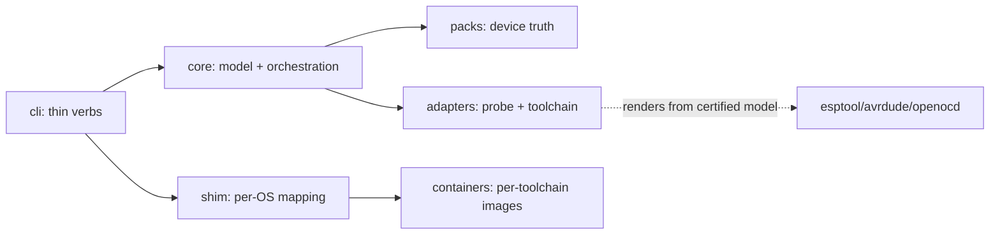
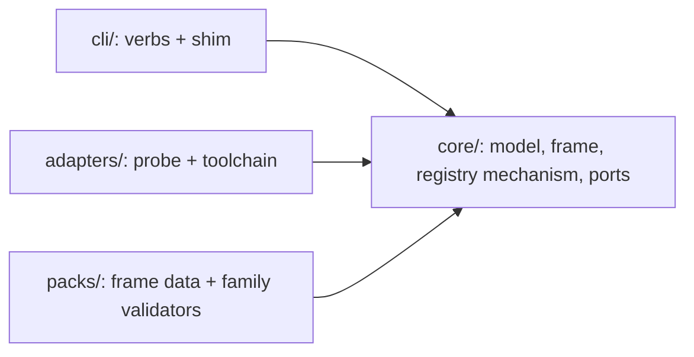

# Architecture Spine — universal-mcu-env

## Design Paradigm

Hexagonal: a vendor-neutral core owns the certified device model and orchestration; hardware packs (device truth), toolchains, and probe backends are adapters. Namespaces: `core/` (model, validation, verbs), `packs/` (frame + family blocks), `adapters/probe/`, `adapters/toolchain/`, `cli/` (thin verbs + shim).



Dependency direction (who may depend on whom — nothing device-specific is depended on *by* core):



## Invariants & Rules

### AD-1 — Hexagonal core, adapters at the edge [ADOPTED]

- **Binds:** all
- **Prevents:** vendor logic leaking into the core; STM32 becoming the core by accident
- **Rule:** Only `core/` may define shared vocabulary. Packs, toolchains, and probes integrate exclusively as adapters behind port interfaces. A new brand ships an adapter plus pack sections; core diffs are forbidden for brand additions.

### AD-2 — Core owns the device model; adapters render only

- **Binds:** CAP-1, CAP-3, CAP-5
- **Prevents:** per-adapter re-derivation of device facts (the openocd-target / core_0-copy drift class)
- **Rule:** The core validates one canonical device model at pack load, including dispatching family blocks to validators registered by family in `packs/` (registry owned by core; adapters never validate). Adapters receive the certified model and own only tool rendering from it; no adapter parses, guesses, or re-derives device semantics.

### AD-3 — No single flash tool; verbs speak, adapters act

- **Binds:** CAP-3, CAP-5
- **Prevents:** a least-common-denominator flash path; core case-per-tool logic
- **Rule:** The core issues `flash`/`debug` verbs against the model. Per-brand HOW lives in adapters (avrdude, esptool, OpenOCD variants); per-device WHAT lives in packs.

### AD-4 — Pack shape: shared frame plus family blocks

- **Binds:** CAP-1, CAP-4
- **Prevents:** junk-drawer schemas; N incompatible vendor formats
- **Rule:** Every pack carries the shared frame (identity, cores, memory, probe ref, proof ritual). Family-specific needs (fuses, partitions, image lists) live in typed blocks each validated by its owning family; unknown blocks are rejected.

### AD-5 — Hardware pack and run config never merge

- **Binds:** CAP-1, CAP-4
- **Prevents:** invocation concerns polluting device truth (language/probe leaking into packs); silent field-level overrides
- **Rule:** Language, pack reference, probe backend, and output are run config (CLI domain). Exactly one device-description source per invocation: `--mcu-config` XOR individual flags — whole-source replacement, never field-level merge. Shape is derived from pack data, never a parameter.

### AD-6 — Thin CLI verbs

- **Binds:** CAP-1, CAP-2, CAP-3
- **Prevents:** hardware knowledge in a third place (commands), forcing CLI edits per device
- **Rule:** Verbs orchestrate only: load pack → validate model → hand to adapter → render verdict. The adapter interface carries multi-piece results and proof back.

### AD-7 — Single stateless-exec mechanic with cache volumes

- **Binds:** CAP-2, CAP-3
- **Prevents:** container-state drift; dev-container lifecycle management; silent cross-lane cache divergence
- **Rule:** Every verb including `dev` is one stateless container exec; images carry full toolchains; caches persist in named volumes keyed by image digest plus project hash, with ownership and invalidation owned by `core/` (image bump invalidates); the project bind-mounts. Nothing of value lives only in a container.

### AD-8 — Per-toolchain images, the resolved stack selects

- **Binds:** CAP-2, CAP-3
- **Prevents:** multi-gigabyte fat pulls; coupled toolchain bumps
- **Rule:** One OCI image per build stack (`make-cmsis`, `cargo-cortex`, `idf-cmake`, later `avr`). The image is resolved by the **pack-declared stack** (AD-11), not by the language flag: a lookup interface owned by `core/` maps stack → image, and toolchain adapters register their images against it (registration, not core edits, keeps AD-1). The language flag stays run config (AD-5) and only selects among the stacks a pack declares. Identical image serves interactive and transparent modes.

### AD-9 — Probe passthrough owned by the shim

- **Binds:** CAP-3, CAP-5
- **Prevents:** per-OS `/dev` knowledge leaking into core or adapters
- **Rule:** Packs declare connection requirements (VID/PID, serial pattern, or network). The shim maps them per OS and hands core/adapters a prepared endpoint in the core-owned endpoint struct (transport + address, never a bare path string).

### AD-10 — Proof ladder

- **Binds:** CAP-3
- **Prevents:** unverifiable "it flashed" claims; incomparable cross-adapter verdicts
- **Rule:** Run proof prefers automated probe readback, then LED, then manual register inspection as accepted fallback. Each pack declares its rung. Proof results use the core-owned proof struct (rung + evidence payload); adapters must fill every rung they certify comparably.

### AD-11 — Build stack is pack-declared and language-keyed [ADOPTED]

- **Binds:** CAP-1, CAP-2, CAP-3; AD-5, AD-8
- **Prevents:** the language flag conflating source language with build system and toolchain image; impossible stacks (an IDF build for an STM32 pack); renderers branching on the language string
- **Rule:** Each pack declares a `stacks` map — **part of the shared frame, not a family block** — from source language to a build-stack id (`make-cmsis`, `cargo-cortex`, `idf-cmake`). `core/` validates the map's shape; the owning family registers each stack id and its contract (template family, image, build command) (AD-13). The resolved stack — never the language string — selects the template family, the toolchain image, and the build command. The rendered project persists its resolved stack id (e.g. under `.mu/`) so verbs that load no pack (`build`, `dev`) resolve identically. A (pack, language) pair with no declared stack is a loud error, never a default; there is no CLI stack override.

### AD-12 — Split the probe port into FlashPort and DebugPort [ADOPTED]

- **Binds:** CAP-3, CAP-5; AD-3, AD-6
- **Prevents:** programming-only devices fabricating debug semantics; an ABC narrower than its callers (`render_argv`/`proof_for`/`last_transcript` undocumented)
- **Rule:** Programming is **FlashPort** (`render_argv`, `flash`, `proof_for`, `last_transcript`); sessions are **DebugPort** (`debug`/`monitor`). Every probe backend implements FlashPort; a backend implements DebugPort only where the device supports attach. The CLI MUST fail a verb whose port the backend does not implement, never fabricate a handle. Proof rungs are owned by the port that can certify them — write/readback rungs by FlashPort, attach/register-inspection rungs by DebugPort; a backend certifies only the rungs its implemented ports produce, and the run reports the highest certified rung (AD-10), never an uncertifiable one.

### AD-13 — Family block validators ship with device truth [ADOPTED]

- **Binds:** all; AD-1, AD-2, AD-4
- **Prevents:** core diffs for brand additions (an AD-1 violation); one family's validators becoming the core by accident
- **Rule:** `core/` owns only the frame, the registry mechanism, and dispatch. Family block validators live alongside `packs/`. Registry **keys are qualified by (family, block name)** — two families must not silently share one key, and `FAMILY_BLOCKS` is the dispatch source, not a write-only side table. The loader attaches every validated block to the model **generically**: no hardcoded family block names and no family-flavoured defaults in `core/`. A new brand adds validators + pack sections + adapters and requires **zero core diffs** — the AD-1 acceptance test.

### AD-14 — Artifacts are gated on model facts; connection requirements are pack-declared [ADOPTED]

- **Binds:** CAP-1, CAP-3, CAP-5; AD-2, AD-9
- **Prevents:** STM32 artifacts (`openocd.cfg`, CMSIS config headers, vendor trees) leaking into non-STM32 trees; dead pack `probe:` facts; a hardcoded probe VID list in `cli/`
- **Rule:** A renderer emits a tool artifact only when the model carries the corresponding fact (an `openocd` block → `openocd.cfg`; a **family-declared vendor-source fact** → vendor tree — never inferred from a pack-id prefix). The pack's `probe:` block declares the connection requirements; an explicit CLI selector **replaces** them as a whole source (AD-5 — never a field-level merge; the CLI wins when present), and the family registers autodetect IDs (no hardcoded list in `cli/`).

### AD-15 — Verification matrix is (pack, stack) [ADOPTED]

- **Binds:** CAP-3; AD-10, AD-11
- **Prevents:** a per-language builder assumption that cannot host a third build system; evidence keys that do not compare across stacks
- **Rule:** The verify harness enumerates **`(pack, stack)`** cells — the cell id is the deduped `(pack, stack)` pair, not `(pack, language)`. Each stack registers its build command and its size/fit check, and returns them in a **shared, stack-neutral build-evidence envelope** (stack, command, exit, artifact path, size/fit verdict). Flash-proof keys remain the AD-10 SUBSET-comparable set (`pieces`, `verified`); build-evidence keys and flash-proof keys never mix.

### AD-16 — Seam refactors precede new-device work [ADOPTED]

- **Binds:** all
- **Prevents:** a new device baking in coupling that must later be untangled across two devices; drift driven by a second board
- **Rule:** The stack axis (AD-11), port split (AD-12), validator relocation (AD-13), artifact gating (AD-14), and verify axis (AD-15) SHALL land on the STM32-only tree first. Acceptance: the suite is green and rendered trees and tool argv are unchanged **for every supported path**; where a seam deliberately changes a present-but-wrong path (the fabricated debug handle of AD-12; the dead pack `probe:` block of AD-14), that change is confined to the seam and its tests are updated in the same slice. New-device slices land afterwards as pure additions.

### AD-17 — Operational envelope is named, not implied [ADOPTED]

- **Binds:** all; AD-7, AD-9
- **Prevents:** the runtime/host envelope being discovered per-lane instead of owned once; undocumented host assumptions (container engine, network, USB access, platform) spreading
- **Rule:** The operating envelope is stated: the container runtime (`docker`), the host tools `create` needs (git; network for vendoring), USB/sysfs access and the container cgroup/permission model for probes (AD-9), and the pinned container platform (`linux/amd64`) each have one named owner. A lane needing a different envelope (Windows native, a non-docker runtime) is an explicit Deferred item, never an undocumented assumption.

## Consistency Conventions

| Concern | Convention |
| --- | --- |
| Naming (ids, branches, images) | Tickets `<kind>-<NNN>-<slug>`; branches `ticket/<id>-<slug>`; images `<family>:<toolchain-version>` |
| Data & formats | Pack YAML: shared frame + typed family blocks; origins hex strings, sizes `<n>[K/M/G]`; one device-description source per invocation, whole-source replacement only |
| State & cross-cutting | Ephemeral containers; caches in named volumes; errors carry verb + adapter + proof-attempt; evidence rule governs claims |
| Build stacks & ports | Stacks are pack-declared, language-keyed; stack ids registered by family (`make-cmsis`, `cargo-cortex`, `idf-cmake`); probe ports are FlashPort (always) + DebugPort (attach-capable only) |

## Stack

| Name | Version |
| --- | --- |
| Python (engine + shim) | >= 3.11 |
| uv (dep management) | >= 0.13 (current 0.13.1) |
| Docker (container runtime) | Engine/Desktop; images pinned `linux/amd64` |

## Structural Seed

```text
engine/
  cli/            # thin verbs: create/dev/build/flash/debug + shim
  core/           # device model + frame + registry mechanism + ports (FlashPort, DebugPort, ToolchainPort)
  packs/          # frame data + per-family block validators (AD-13) + packs
  adapters/
    probe/        # openocd (ST fork), probe-rs, esptool, avrdude, stlink-fallback
    toolchain/    # per-stack build defs + image registration against the core lookup (AD-8, AD-11)
```

## Capability → Architecture Map

| Capability / Area | Lives in | Governed by |
| --- | --- | --- |
| CAP-1 create-from-pack | `cli/create` + `core` + `packs/` | AD-4, AD-5, AD-6, AD-13, AD-14 |
| CAP-2 interactive-shell | `cli/dev` + shim + images | AD-7, AD-8, AD-11, AD-17 |
| CAP-3 transparent-build-flash | `cli` + shim + adapters | AD-2, AD-3, AD-6, AD-7, AD-9, AD-10, AD-11, AD-12, AD-14, AD-15, AD-17 |
| CAP-4 user-config | `core` validation + packs | AD-4, AD-5, AD-13 |
| CAP-5 probe-adapter | `adapters/probe/` | AD-2, AD-3, AD-9, AD-12, AD-14 |
| CAP-6 cpp-deps | spike first; `adapters/toolchain/` | AD-1 (mechanism pending spike) |

## Deferred

- Exact pack field lists per family (pack-schema story owns; AVR/ESP blocks draft-until-board-proven).
- Toolchain/probe version pins incl. OCI runtime (pinned per image when images are defined; same story). OpenOCD pins the ST fork/branch, not bare upstream (verified 2026-10-08).
- STM32 toolchain decision: STM32CubeCLT (v1.22.0 verified 2026-10-08) vs vanilla ARM GCC — decided when images are defined.
- C/C++ dep mechanism (spike pending; integration post-V1 unless cheap).
- Image registry choice and multi-language project image resolution (AD-11 makes the resolved stack the resolution key; the concrete mapping lands with the stack axis).
- Non-docker runtimes and the Windows native lane: the operational envelope (AD-17) is docker-on-Linux/macOS for now; a second runtime or Windows is out until explicitly scoped.
- Windows native lane; pack validator/generators (post-V1).
- Shim implementation details beyond Python+uv.
